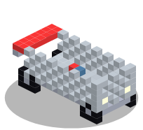
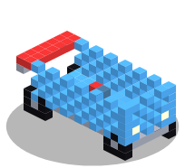
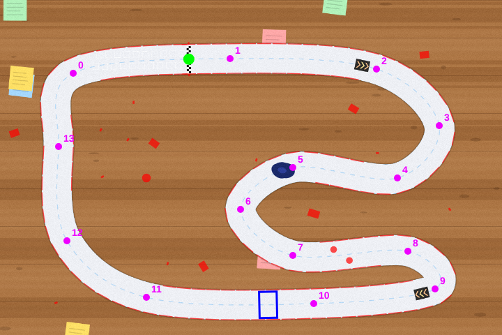

# Adding cars and tracks

A new car is two edits: a stats entry in `js/tracks.js` and a voxel model in `js/models.js`. A new
track is one entry in `js/tracks.js`, plus a line to put it in a cup. There is no build step: save,
reload, play.

The two worked examples below, the **Trolley Dash** shopping cart and the **Paper Chase** track with
its **Paper Cup**, are in the game, so you can read their code next to this guide. If you follow along
by typing them in yourself, give yours a different `id` (say `cart2` and `paperchase2`) so they don't
clash with the real ones.

## Before you start

| File | What you edit there |
| --- | --- |
| `js/tracks.js` | `CARS` (car stats and prices), `TRACKS` (layouts), `CUPS` (which tracks each cup races), `THEMES` (table look, props, lighting), `RIVALS` |
| `js/models.js` | `CAR_BUILD` (one function per car that places its voxels), the prop builders (`P.bowl`, `P.pencil` and so on) |
| `js/ui.js` | `CUP_RIVALS` (the three named rivals in each cup) |
| `js/audio.js` | `SONGS` (one per theme), only for a new theme |

**To test,** serve the folder and open it in a browser:

```
python3 -m http.server 8080
```

Then open `http://localhost:8080`. Opening `index.html` straight from disk works too, but the service
worker only runs over http. In the game, **Settings > Developer options** has *Unlock all cars* and
*Open all cups*, so you can try a new car or track without earning it.

**To ship,** run `node tools/bump-version.mjs` before you commit, or installed copies won't pick the
change up. You only touch `sw.js` by hand if you add a new file (add it to `ASSETS`); new cars and
tracks don't need that.

Two habits save time: hard-refresh (Ctrl+Shift+R) after each change, since the service worker caches
old files, and keep the browser console open (F12): a mistake in a car or track usually shows up
there as an error naming the line.

## Cars, part 1: the stats entry

Every car is one line in the `CARS` list in `js/tracks.js`. The stats are numbers from 0 to about 1,
and the game turns them into speeds and forces in `stats()` in `js/game.js`. Here is the first car:

```javascript
{ id: 'zip', name: 'Zip', desc: 'Nimble hatchback. Easy to drive.', top: 0.6, accel: 0.65, grip: 0.65, mass: 0.5, price: 0, paints: ['#ff4d5e', '#ffd43b'] },
```

| Field | What it does in a race | Range in the game now |
| --- | --- | --- |
| `id` | Internal name. Must match the model's function name in `CAR_BUILD`, and must never change once players own the car (saves store it). | lowercase, no spaces |
| `name`, `desc` | Shown in the garage and shop. The shop search looks inside both. | a short line each |
| `top` | Top speed: 255 + 150 x `top` units a second, +11 per Engine upgrade. | 0.40 (Bulldozer) to 1.04 (Afterburner) |
| `accel` | Acceleration: 300 + 280 x `accel`, +16 per Engine upgrade. | 0.40 to 1.00 |
| `grip` | How quickly sideways sliding dies away, and how sharply it turns. Low grip drifts. | 0.28 to 0.95 |
| `mass` | Weight in collisions: heavier cars shove lighter ones. | 0.20 to 1.80 |
| `price` | Shop price before scaling. The game multiplies every price by `PRICE_SCALE` (0.6) and rounds to 50, so 2000 here costs 1200 coins. `0` = free from the start. | 0 to 7000 |
| `paints` | `[body, accent]` as hex colours. The body is the default paint; players can repaint it. The accent (stripes, the driver's helmet) stays fixed. | |

Optional extras, left out for an ordinary car:

| Field | Effect |
| --- | --- |
| `offroad: 0..1` | Keeps speed on rough ground off the road, and loses less speed crossing drive-over clutter. 1 = barely slowed. |
| `hover: true` | Ignores puddles and goo, and floats a little above the ground. |
| `charge: number` | How fast drifting fills the boost meter. 1 is normal, 2 is twice as fast. |
| `lift: number` | How high a spring pad throws the car. 1 is normal. It does not change jumps off ramps. |

The shop works out its tags from these fields (Off-road at 0.5 or more, Floats, Big jumps above 1.1,
Fast boost charge above 1.1, Heavyweight at 1.2 or more, Featherweight at 0.3 or less), so there is
nothing extra to fill in for them.

**Balancing tip:** a car that is good at everything is no fun to own. Give each car one strength and
one weakness. The Dragster has the best acceleration in the game and the worst grip; the Bulldozer is
the heaviest and the slowest. Upgrade prices follow the car's price, so dearer cars cost more to
upgrade.

## Cars, part 2: building the model

Each car's look is a function in `CAR_BUILD` in `js/models.js` that fills a 16 x 10 x 9 grid of
blocks (voxels). The game turns the grid into a lit, shaded 3D model and draws the garage and shop
pictures from the same grid, so there is nothing else to draw.

**The grid.** Each block is 2.2 world units, so a car is about 35 units long and 20 wide.

| Axis | Runs from | To |
| --- | --- | --- |
| `x` (length) | 0 = rear bumper | 15 = front bumper |
| `y` (height) | 0 = road | 9 = roof (most cars stop around 6 or 7) |
| `z` (width) | 0 = left wheels | 8 = right wheels (4 is the middle) |

Seen from above, a typical car with wheels at `x` 3 and 12 looks like this (W = wheel, B = body):

```
 z=8  ..WWW......WWW..
 z=7  .BBBBBBBBBBBBBB.
  ...  (body rows)
 z=1  .BBBBBBBBBBBBBB.
 z=0  ..WWW......WWW..
      x=0           x=15  (front)
```

**The function.** It receives four things: `v` (the grid), `P` (the body colour), `A` (the accent
colour) and `r` (a random number source, the same every time, for slight colour variation). Colours
are `[red, green, blue]` from 0 to 1. Use `P` for anything that should repaint and `A` for stripes and
trim.

| Call | Does |
| --- | --- |
| `v.set(x, y, z, colour, glow)` | One block. `glow` from 0 to 1 makes it emit light (headlights use 1). |
| `v.box(x0, y0, z0, x1, y1, z1, colour, glow, jitter, r)` | A solid box, both corners included. `jitter` (around 0.05) varies the shade block by block so big panels don't look flat. |
| `v.clear(x, y, z)` | Removes a block, for holes and cut corners. |
| `wheels(v, [3, 12])` | A wheel on each side at each `x` listed. `wheels(v, [3, 12], true)` gives big off-road wheels. Two more numbers move them inward, for narrow cars: `wheels(v, [3, 12], false, 1, 7)`. |
| `helmet(v, x, y, z, A)` | The driver: a face block, a helmet in the accent colour, a visor. |
| `hull(v, P, r, widthFn, topFn)` | A curved body: for each `x`, `widthFn(x)` gives the half-width and `topFn(x)` the top height. Good for noses, fins and rounded shapes. |
| `sphere(...)`, `cyl(...)` | Balls and cylinders, as used by the duck, cupcake and saucer. |

Ready-made colours: `TIRE`, `HUB`, `GLASS`, `DARK`, `HEAD` (headlight), `TAIL` (tail light), `SKIN`.
For any other colour use `hex('#ff922b')`, and `U.shade(colour, 0.8)` for a darker version.

**Things to know:**

- Blocks outside the grid are silently dropped, so a model that looks cut off has gone past 15, 9 or 8.
- The model doesn't change how the car collides: every car is a circle of the same size in the physics.
- Lighting, shadows and the soft shading in corners are added automatically. Glowing blocks also light
  the bloom effect, so a few bright headlights and tail lights go a long way.
- The quickest way to design is to copy the closest existing car and change it. `zip` is the simplest;
  `hotrod`, `limo` and `bus` show common shapes; `burger`, `quack` and `wyrm` show `hull` and spheres.

## Cars, part 3: worked example, a shopping cart

This is how **Trolley Dash** was added: a shopping cart that turns sharply and is light enough to get
pushed around.

**Step 1: the model.** In `js/models.js`, inside `CAR_BUILD`, next to the other cars:

```javascript
    cart(v, P, A, r) { // a shopping cart
      wheels(v, [2, 13], false, 1, 7);            // small wheels, tucked in
      v.box(1, 1, 2, 14, 1, 6, HUB);               // the chassis rails
      // the basket: open wire walls in the body colour
      for (let x = 2; x <= 14; x++) for (let y = 2; y <= 6; y++) {
        if ((x + y) % 2) continue;                 // every other block: a wire grid
        v.set(x, y, 1, P); v.set(x, y, 7, P);       // the two sides
      }
      for (let y = 2; y <= 6; y++) for (let z = 1; z <= 7; z++) if ((y + z) % 2 === 0) v.set(14, y, z, P);   // the front wall
      v.box(2, 2, 2, 13, 2, 6, P, 0, 0.05, r);     // the basket floor
      v.box(0, 6, 1, 1, 6, 7, A);                  // the handle, in the accent colour
      v.set(0, 5, 1, HUB); v.set(0, 5, 7, HUB);
      helmet(v, 7, 3, 4, A);                       // the driver, sitting in the basket
      v.set(14, 3, 2, HEAD, 1); v.set(14, 3, 6, HEAD, 1);   // headlights
    },
```

**Step 2: the stats.** In `js/tracks.js`, a line in `CARS`. Where it goes in the list sets its place
in the garage strip; the shop sorts by price anyway.

```javascript
    { id: 'cart', name: 'Trolley Dash', desc: 'A shopping cart. Turns on a coin, rattles at speed.', top: 0.58, accel: 0.78, grip: 0.86, mass: 0.35, price: 900, paints: ['#adb5bd', '#e03131'] },
```

The `id` (`cart`) is the same word as the function name. With the 0.6 price scaling, 900 becomes 550
coins in the shop.

**Step 3: try it.** Reload, open **Settings > Developer options > Unlock all cars**, go to the
Garage, pick the car and race. Check it from a few angles: the garage picture is drawn from the same
model, so a gap or a stray block shows up there first.

**Optional extras:**

- **Make it a cup prize:** set `unlock: 'cart'` on a cup in `CUPS`. Winning that cup then gives it
  free, and the shop says so. Each cup has one prize, so this replaces the cup's current one. (Trolley
  Dash is the Paper Cup's prize.)
- **Give it to a named rival:** change that rival's `car` in `RIVALS`, e.g.
  `{ name: 'Tinker', car: 'cart', ... }`. You don't need this for the car to appear in races: in Quick
  Race and Knockout, rivals regularly pick a random car from the whole list.
- **Never rename the `id` later.** Players' saves store which cars they own by `id`, so a renamed car
  disappears from their garage. Changing `name`, `desc`, stats, price or the model is always safe.

The finished cart, as the garage draws it, in its default grey and repainted blue:

 

## Tracks, part 1: the layout

A track is one entry in the `TRACKS` list in `js/tracks.js`. Its shape is a loop of points; the game
draws a smooth road through them, paints the table, dresses the edges with props and builds
everything else from the theme. Cereal Circuit, minus its features:

```javascript
{
  id: 'cereal', name: 'Cereal Circuit', theme: 'breakfast', W: 2400, H: 1700, width: 130, seed: 11, start: [760, 285],
  pts: [[320, 360], [900, 270], [1500, 330], [2050, 300], [2150, 650], [1900, 900], [1450, 820], [1150, 1000],
        [1350, 1270], [1900, 1250], [2080, 1420], [1700, 1560], [900, 1540], [400, 1400], [260, 850]],
  // zones, ramps, boosts, pieces, hazards: see part 2
},
```

| Field | Meaning |
| --- | --- |
| `id` | Internal name, used for best times and ghosts. Don't rename it later. |
| `name` | Shown in menus. |
| `theme` | Which table it's on: the surface painting, lighting, edge props, scattered props and song. One of `breakfast`, `desk`, `sandbox`, `pool`, `bath`, `toybox`, `garage`, `computer`, `bakery`, `frost`, `picnic`, `town`. |
| `W`, `H` | Table size in world units. Current tracks run from 2250 x 1300 to 3000 x 1000; a lap takes the computer drivers 15 to 30 seconds. |
| `width` | Road width. 115 is tight, 130 is normal, 150 is wide and fast. |
| `seed` | Any number. It shuffles where the scattered props land; change it if they land somewhere you don't like. |
| `pts` | The loop, as `[x, y]` points. **x** runs left to right, **y** top to bottom, like pixels in a picture, from 0 up to `W` and `H`. The last point joins back to the first. Cars drive in the order you list them. |
| `start` | Optional `[x, y]` near where the start line should go. Without it, the game picks the straightest stretch. |
| `cross: true` | Only when the road crosses itself (Desk Dash, Lucky Clover), so the crossing counts as road in both directions. |

**Drawing the loop:**

- Sketch on graph paper or in any image editor at the table's size, then read off 10 to 20 points
  around the loop. Put more points where corners are sharp and fewer on straights.
- Keep every point at least 250 units from the table edge. Most themes have a drop at the edge; on
  tracks without walls, a car that misses a corner falls to the floor.
- Keep separate stretches of road at least `width` + 120 apart, or the two roads and their edge props
  run into each other. Crossings are the exception.
- The road follows a smooth curve through the points, so a corner comes out rounder than the points
  suggest. For a true hairpin, put three points close together.
- The start line needs a clear stretch behind it: the grid holds up to 20 cars, about 480 units of
  road. Puddles and boost pads that land there are moved out of the way automatically; ramps and
  hazards are your job to keep out.

Every track also gets a **mirrored** version for free: the same loop driven the other way. Everything
placed along the lap is flipped to match.

## Tracks, part 2: features

Features on the road are placed by **how far round the lap** they sit, not by `x, y`. That makes them
land on the road even if you later move the points.

- `t` is the fraction of the lap from 0 to 1, counted from the **first point in `pts`** in driving
  order (not from the start line). `t: 0.5` is halfway round.
- `off` is the distance sideways from the middle of the road, in world units. Positive is to the
  driver's **right**, negative to the left. A road 130 wide runs from -65 to 65.

| Feature | Format | Notes |
| --- | --- | --- |
| Spills (`zones`) | `{ t, off, rx, ry, type, look }` | `rx` = length along the road, `ry` = width across it. `type: 'slick'` loses grip (puddles, ice, oil); `type: 'sticky'` slows you down (jam, mud). Looks: `milk`, `jam`, `water`, `ink`, `slime`, `oil`, `sawdust`, `coffee`, `flour`, `batter`, `ice`, `ketchup`, `lemonade`, `mud`. Hover cars ignore both types. |
| Boost pads (`boosts`) | `{ t, off }` | A free burst of speed. Two or three per lap is typical. |
| Ramps (`ramps`) | `{ t, len, look, gap }` | `len` is the length in blocks (26 to 30 works; one block = 3 units). A car over about 90 speed takes off at the top. Looks: `book`, `ruler`, `plank`, `rack`, `sponge`, `block`, `tape`, `board`, `key`, `cookie`, `snow`, `bread`, `bridge`. Add `gap: 40` to 46 for a drop just past the ramp that you have to clear; cars that fall in come back on the far side. Put ramps on straights: a car launched mid-corner flies off the road. |
| Swinging arms | `{ type: 'sweeper', t, side, look, speed }` in `hazards` | An arm pivoting from the roadside and sweeping across. `side: 1` = from the right, `-1` = from the left. `speed` defaults to 1.2. Looks: `spoon`, `ruler`, `shovel`, `cue`, `glow`, `wrench`, `usb`, `cane`, `straw`, `barrier`. |
| Things crossing the road | `{ type: 'shuttle', t, look, speed }` in `hazards` | Slides back and forth across the road. `speed` defaults to 0.7. The look can be any prop (below); `beetle` gives a ladybug, `pin` a rolling pin, `vacuum` a robot vacuum. `look: 'train'` runs a toy train across a painted level crossing and sounds its horn. |
| Bumpers | `{ type: 'bumper', t, off }` in `hazards` | Pinball bumpers that fling cars away. Pairs at `off: -30` and `30` make a slalom. |
| Spring pads | `{ type: 'spring', t, off }` in `hazards` | Throws the car into the air. |
| Big props (`pieces`) | `['name', x, y, turn, options]` | Scenery placed by `x, y`, usually inside the loop. `turn` (radians) and `options` are optional, e.g. `['book', 640, 790, 1.4, { w: 36, d: 24, h: 10 }]`. **A piece that would sit on the road is skipped**, with a warning in the console. These are solid. |
| Pool balls (`balls`) | `[[t, off], ...]` | Pushable balls that can drop into the pockets. Pool table only. |
| A drain (`drain`) | `[x, y, radius]` | A hole in the table you can fall through, as on Bath Time. |

Prop names for `pieces` and `shuttle` looks: `apple`, `battery`, `block`, `bolt`, `book`, `bottle`,
`bowl`, `bucket`, `candle` (glows), `candycane`, `castle`, `chalk`, `coffee`, `cone`, `cookie`, `cue`,
`duck`, `egg`, `eraser`, `flour`, `glass`, `house`, `juicebox`, `ladybug`, `lamp` (glows), `marble`,
`measure`, `melon`, `mouse`, `mugpens`, `oilcan`, `pinecone`, `robot`, `rollingpin`, `sandwich`,
`screwdriver`, `snowman`, `soap`, `sponge`, `tape`, `toast`, `train`, `tree`, `vacuum`, `wrench`.
They can go on any table, not only their own theme's.

You don't place the edge props (cereal loops, pencils, pebbles and so on) or the scattered clutter:
the theme does that. Small edge props can be driven over and only slow cars down; pencils, glow
sticks, trees and big props are solid. Three rows of power-up boxes are also placed automatically, on
clear stretches about a quarter, half and three-quarters of the way round.

## Tracks, part 3: worked example, Paper Chase

This is how **Paper Chase**, a desk track with a long S-bend through the middle, and the **Paper
Cup** that races it were added. It was tested with 12 cars in both directions: nobody fell off, and
laps take about 22 seconds.

**Step 1: the track.** In `js/tracks.js`, at the **end** of `TRACKS`, after Night Oval:

```javascript
    {
      id: 'paperchase', name: 'Paper Chase', theme: 'desk', W: 2400, H: 1600, width: 125, seed: 151, start: [900, 290],
      pts: [[350, 350], [1100, 280], [1800, 330], [2100, 600], [1900, 850], [1400, 800], [1150, 1000], [1400, 1220],
            [1950, 1200], [2080, 1380], [1500, 1450], [700, 1420], [320, 1150], [280, 700]],
      zones: [{ t: 0.4, off: 0, rx: 60, ry: 45, type: 'sticky', look: 'ink' }],
      ramps: [{ t: 0.72, len: 28, look: 'ruler' }],
      boosts: [{ t: 0.2, off: 0 }, { t: 0.62, off: 0 }],
      pieces: [['mugpens', 700, 850], ['book', 1500, 1020, 0.3, { w: 36, d: 24, h: 8 }], ['eraser', 2150, 1000]],
      hazards: [{ type: 'sweeper', t: 0.28, side: 1, look: 'ruler' }, { type: 'bumper', t: 0.52, off: -30 }, { type: 'bumper', t: 0.53, off: 30 }],
    },
```

Always add tracks at the end. Cups find tracks by their position in the list, counting from 0, so
inserting one in the middle shifts every track after it into the wrong cup. Paper Chase is number 15,
so the next new track will be 16.

**Step 2: put it in a cup.** A track only appears in Quick Race, Time Trial and Knockout once a cup
that races it is open. The Paper Cup sits in `CUPS` in `js/tracks.js` just before the Champion Cup
(each cup opens with a podium in the one before):

```javascript
    { id: 'paper', name: 'Paper Cup', races: [[15, false], [1, false], [15, true]], ai: 1.0, reward: 900, unlock: 'cart' },
```

Each race is `[track number, mirrored]`. Keep it to three races: the standings screen assumes three.
`ai` sets how hard the rivals drive (0.9 for the first cup up to 1.07 for the last), `reward` is the
cup's coin prize before the payout multiplier, and `unlock` is the car it gives (leave it out for no
car).

Then give the cup its three named rivals in `CUP_RIVALS` in `js/ui.js`. **The game stops with an
error if a cup has no entry here.**

```javascript
  const CUP_RIVALS = { paper: ['Pip', 'Tinker', 'Lola'], twist: [...], ...
```

To put a track in an existing cup instead, change one of that cup's `races` to point at it.

Adding a cup in the middle of the order is safe for existing saves: on load, any cup that comes
before one the player has already opened is opened too.

**Step 3: check it.** Reload, then **Settings > Developer options > Open all cups**, and race it from
Quick Race. Then check each of these:

1. The console (F12) shows no `piece on track` warning. If it does, a piece sits on the road and was
   skipped: move it.
2. The start line is on a straight, with nothing on the road for a good way behind it.
3. Drive it with 19 rivals in both directions. Watch for cars stacking up in one corner (too tight:
   spread its points out) or flying off a ramp into scenery (move the ramp to a straight).
4. The track picture on the track list looks the way you drew it.

**Common problems:**

- **A spill, ramp or hazard is in the wrong place:** remember `t` counts from the first point in
  `pts`, not from the start line.
- **Two stretches of road merge into one:** they're closer than `width` + 120. Move the points apart,
  or add `cross: true` if they're meant to cross.
- **Cars fall off a corner:** it's too near the table edge, or too sharp at that speed. Pull the
  points in from the edge, or add a point to round the corner.
- **The scattered props look crowded or bare:** try another `seed`.

The layout as the game builds it. Magenta dots are the `pts` (numbered), the green dot is the start
line, red marks are solid props, and the blue box is the ramp:



## Going further

**A new table (theme).** Every track sits on one of the twelve themes in `THEMES` in `js/tracks.js`.
A new one needs four things:

1. A `THEMES` entry: the `ground()` painter for the table surface, the road paint colours, the
   `rough` (off-road) surface, the `border` rows of edge props (each with `spacing`, `offset`,
   `chance`, and `wall: true` or `hard: true` for solid ones), and the `scatter` clutter. Copying the
   closest existing theme and changing it is far easier than starting fresh.
2. A lighting preset in `LIGHT` (sun direction, colours, ambient), named in the theme.
3. A song in `SONGS` in `js/audio.js`, keyed by the theme's id. Without one, the menu tune plays.
4. A dust colour for the theme in the particle colour map in `js/game.js`, so tyres kick up the right
   colour off-road.

**A new prop.** Props are voxel models in the `P` object in `js/models.js`, built with the same
`v.box` and `v.set` calls as cars. Once one is added, its name works in `pieces`, `shuttle` looks and
theme borders.

**Before you commit:**

- Run `node tools/bump-version.mjs`. This changes the version number in `sw.js`, which is how phones
  that installed the game know to fetch the new files. Skip it and players keep the old version.
- Race the new car or track once with 19 rivals, in both directions for a track.
- Check the console for warnings.
- Commit, push, and GitHub Pages picks it up within a minute or two.
